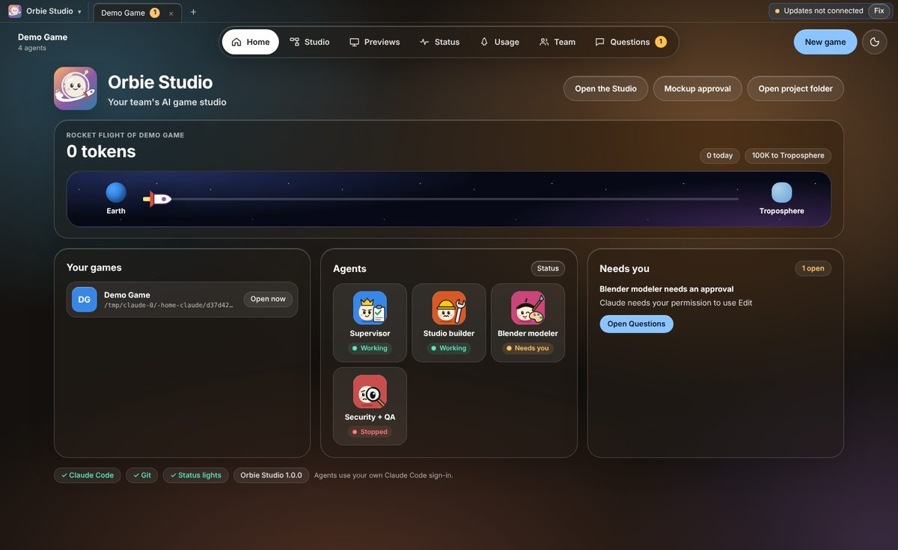
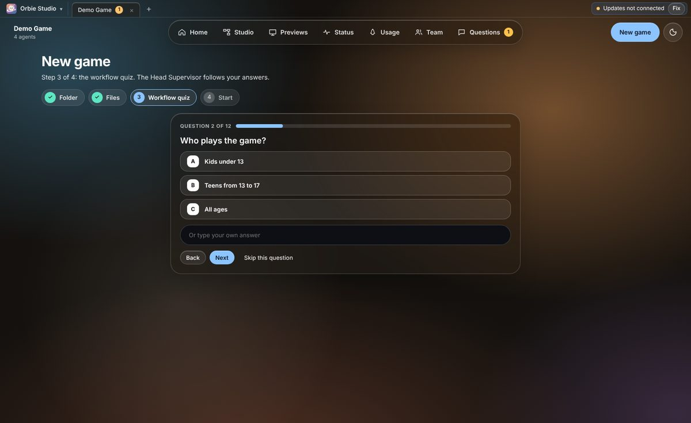
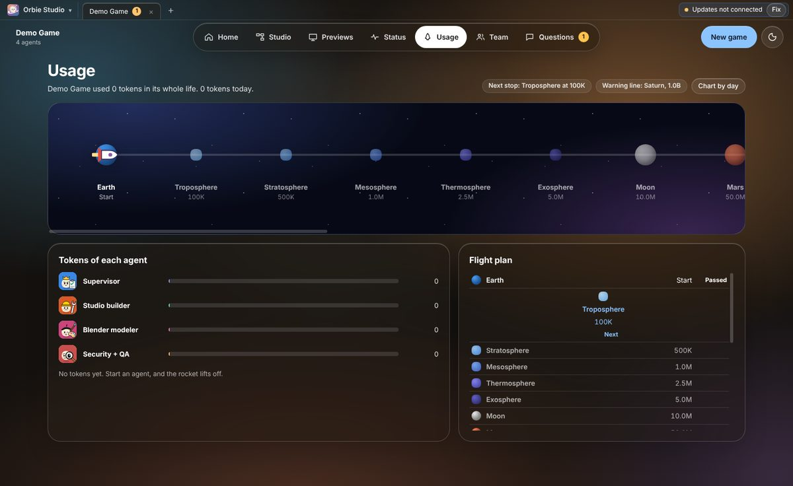
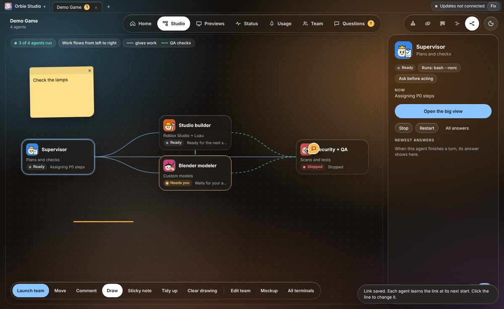

<h1 align="center">Orbie Studio</h1>

<b>Your team's AI game studio</b> A team of AI agents builds your Roblox game with you.

  <a href="https://github.com/ki11phil0405-bit/OrbieStudio/releases/latest"><b>Download the installer</b></a>
  &nbsp;·&nbsp;
  <a href="src/guide/Orbie%20Studio%20Quick%20Guide.pdf"><b>Quick guide (PDF)</b></a>
  &nbsp;·&nbsp;
  <a href="CHANGES.md"><b>What is new</b></a>
  &nbsp;·&nbsp;
  <a href="#support-orbie-studio"><b>Support</b></a>

## Contents

1. [What Orbie Studio is](#1-what-orbie-studio-is)
2. [Set up your PC](#2-set-up-your-pc)
3. [Install Orbie Studio](#3-install-orbie-studio)
4. [Make your first game](#4-make-your-first-game)
5. [The screens](#5-the-screens)
6. [The Studio canvas](#6-the-studio-canvas)
7. [Safety rules](#7-safety-rules)
8. [Updates and help](#8-updates-and-help)

## 1. What Orbie Studio is

Orbie Studio runs a team of AI agents that build a Roblox game with you. Each agent is one Claude Code session with its own job, its own context and its own memory. You see every agent on one screen, you answer their questions, and you approve their work.

The agents work in the folder of your game on your own PC. They use your own Claude Code sign-in.

## 2. Set up your PC

Do these steps once. Each link opens the official page.

| What | Need | How |
|---|---|---|
| **Windows 10 or 11** | Required | Orbie Studio 1.0 runs on Windows. A Mac version is planned. |
| **Claude Code** | Required | Open PowerShell and run `irm https://claude.ai/install.ps1 \| iex`. Then run `claude` once and sign in. Full steps: [Claude Code setup guide](https://code.claude.com/docs/en/setup). |
| **Roblox Studio** | Required | Download Roblox Studio from the [Roblox Creator Hub](https://create.roblox.com/). Sign in with your Roblox account. |
| **Blender** | Optional | The art agent makes 3D models in Blender. Download it from [blender.org](https://www.blender.org/download/). |
| **Git for Windows** | Optional | Git saves versions of your game. Download it from [git-scm.com](https://git-scm.com/download/win). |
| **Tailscale** | Optional | Remote view shows your board on a phone or a Mac. Away from home it needs [Tailscale](https://tailscale.com/download). |

> **Check your setup.** Open Orbie Studio and look at the bottom of the Home screen. Green marks next to "Claude Code", "Git" and "Status lights" mean that the PC is ready.

## 3. Install Orbie Studio

1. Open the [newest release](https://github.com/ki11phil0405-bit/OrbieStudio/releases/latest).
2. Download `Orbie-Studio-Setup-x.y.z.exe`. The quick guide is on the same page.
3. Run the installer. Windows may say "Windows protected your PC". Click **More info**, then **Run anyway**. The app is not code-signed yet.
4. Open Orbie Studio from the desktop or the Start menu.

The installer also puts the quick guide in the install folder. In the app, open the main menu (top left) and click **Quick guide (PDF)**.

## 4. Make your first game

1. Click **New game** (top right).
2. **Folder.** Pick the folder of the game. An empty folder starts a new game.
3. **Files.** Drop your story or book, your art board, your map overview and your main character designs.
4. **Workflow quiz.** Answer 12 questions. The lead agent follows your answers when it decides for you.
5. **Start.** Click **Save and open the Studio**.
6. Click **Launch team**. Each agent starts in its own terminal.
7. Click **Send kickoff**. The lead agent reads your files and writes `GAME_DIRECTION.md` and 12 picture prompts.
8. Click **Mockup**. Add your 12 pictures, read the game direction, then click **Approve the mockup** or **Ask for changes**.

 

> **Pictures cost money.** Orbie Studio does not make the 12 mockup pictures. Make them with the prompts in `mockup/PROMPTS.md` and drop them on the Mockup screen.

## 5. The screens

| Tab | What it shows |
|---|---|
| **Home** | Your games, the agents, the open questions and the rocket of the open game. |
| **Studio** | One card for each agent. A double-click on a card opens the big view with the live terminal. |
| **Previews** | The newest answer and the views of each agent. |
| **Status** | What each agent does now. Start, stop and open each agent. |
| **Usage** | The rocket flight. The rocket passes one stop for each token goal, from Earth to the Andromeda Galaxy. |
| **Team** | Planned: members, hours, questions to the team lead, shared prompts and the money pool. |
| **Questions** | Every question and every approval from the agents. You can also write to one agent. |

The warning line is Saturn, at 1 billion tokens. Agents never pause at the line.

## 6. The Studio canvas

Blue lines show who gives work. Dashed green lines show who checks the work.

| Action | How |
|---|---|
| **See one agent** | Click its card. The side panel shows its status, its newest answers and a message box. |
| **Open the big view** | Double-click a card. The live terminal fills the Studio. Click **Canvas** to go back. |
| **Move a card** | Drag the card. It snaps to the grid. |
| **Connect two agents** | Drag the ball on the right side of a card to another card. Click the line to choose "Gives work" or "Checks the work". Each agent learns the link at its next start. |
| **Comment** | Click **Comment**, then click the canvas or a card. A comment on a card can go to that agent. |
| **Draw and notes** | Click **Draw** to draw on the canvas. Click **Sticky note** to add a note. |
| **Change the layout** | Click one of the five icons on the top right: Tree, Orbit, Lanes, Timeline or Flow. |
| **Change the theme** | Click the moon button on the top right: Dusk, Daylight, Aurora or Midnight. |

## 7. Safety rules

- **Publishing waits for you.** No agent publishes a game. You publish in Roblox Studio yourself.
- **Spending money waits for you.** No agent buys anything.
- **Agents ask first.** The usual mode is "Ask before acting". The mode "Skip all approvals" lets an agent do anything on the PC, so use it only for work that you can undo.
- **Your files stay on your PC.** Only Claude Code sends data, to run the agents.
- **Protect your accounts.** Turn on two-step login for [GitHub](https://github.com/settings/security) and for Roblox.

## 8. Updates and help

- **Updates.** Orbie Studio checks GitHub every 10 minutes. Click **Restart to update** when the title bar offers a new version.
- **Check now.** Open the main menu and click **Check for updates**.
- **Shortcuts.** Press **F1**, or open the main menu and click **Shortcuts**.
- **Open a game.** Press **Ctrl+O**.
- **Claude Code help.** Read the [Claude Code documentation](https://code.claude.com/docs).
- **Other questions.** Ask Cohesive, the team lead.

## Support Orbie Studio

Orbie Studio is free for the team. A tip helps Cohesive pay for the tools behind it.

| Way to pay | Link |
|---|---|
| **Cash App** | [cash.app/$c0hesive](https://cash.app/$c0hesive) |
| **Venmo** | [venmo.com/u/PhilipWerner455](https://venmo.com/u/PhilipWerner455) |

A tip is a gift. It does not buy a license key.

---

<b>For the publisher: how updates work and how to publish a version</b>

### How updates work

Every copy checks `update/orbie-studio.json` on this repo's `main` branch every 10 minutes. When a newer version is listed, Orbie Studio shows **Restart to update**, downloads each file from the commit that version lists, checks its SHA-256, backs up the current version and restarts. Updates that change the app's libraries download the new installer from the release instead.

### Publishing a new version (Cohesive)

1. Change the code, add a `## x.y.z` section at the top of `CHANGES.md`, and set `version` in `package.json`.
2. `npm ci` then `npm run dist` (builds `dist/Orbie-Studio-Setup-x.y.z.exe`).
3. Commit the code, then `npm run release` (writes `update/orbie-studio.json`, pointing at that commit), commit it too, and push `main`.
4. On GitHub, Releases > Draft a new release: tag `vx.y.z` (create it on publish), title `Orbie Studio x.y.z`, attach `dist/Orbie-Studio-Setup-x.y.z.exe` and `src/guide/Orbie Studio Quick Guide.pdf`, Publish.

Copies pick it up within 10 minutes.

### The quick guide

The source of the guide is `build/guide/guide.html`. Run `python3 build/guide/make.py` to build the PDF again.

Created and published by **Cohesive**. © 2026 Cohesive. All rights reserved. The code is public so every copy can update itself; it is not open source.

Built with Electron, xterm.js, node-pty, marked and DOMPurify, used under their licenses.
